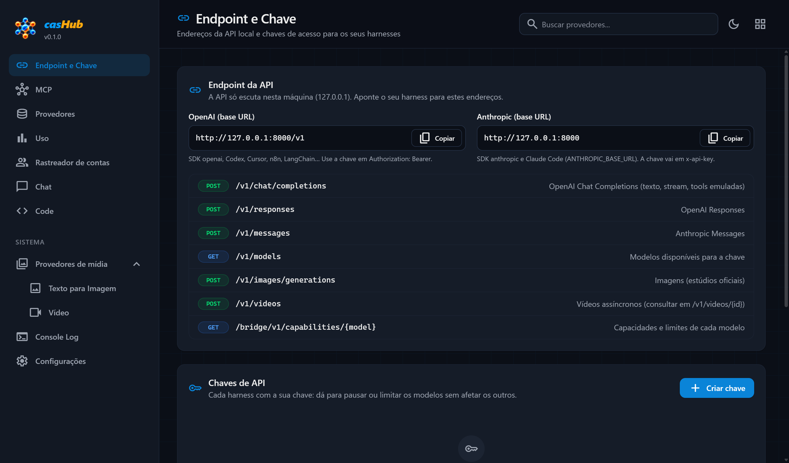
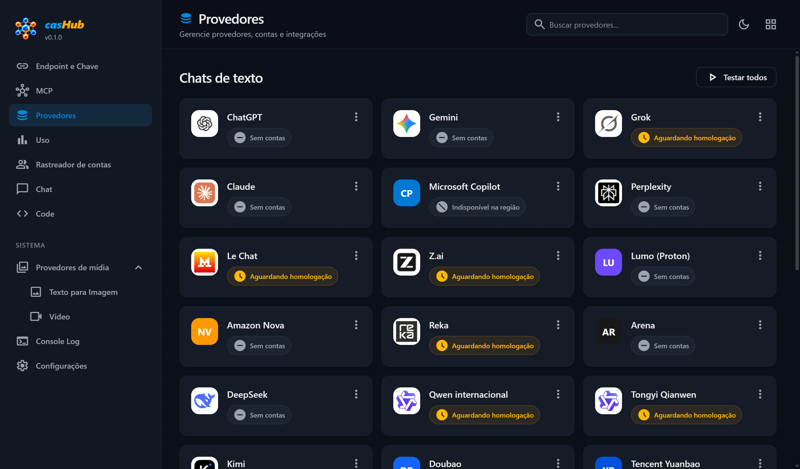
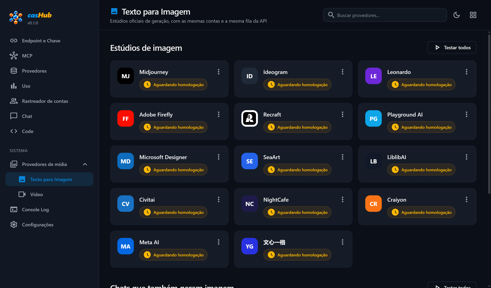
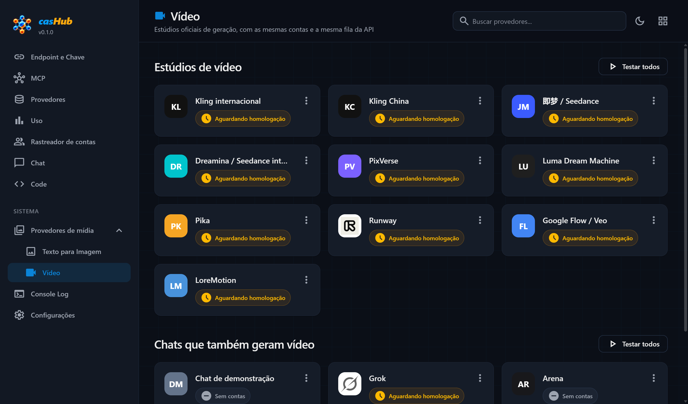
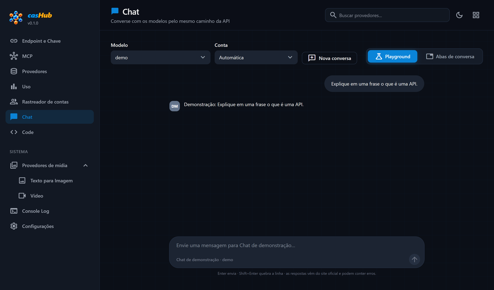
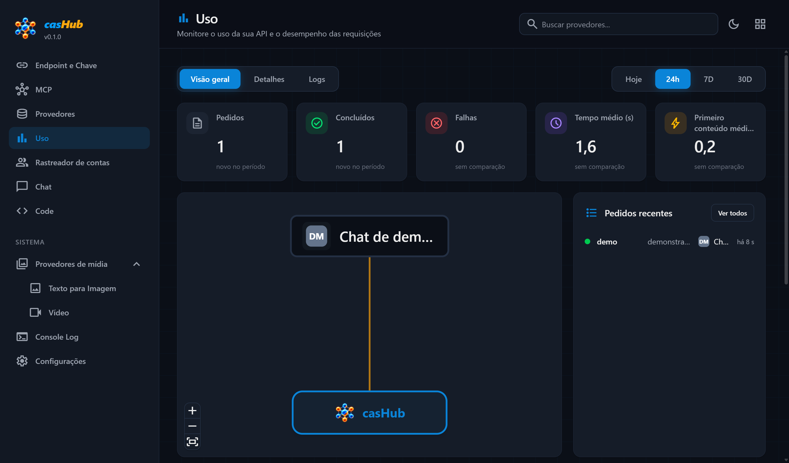
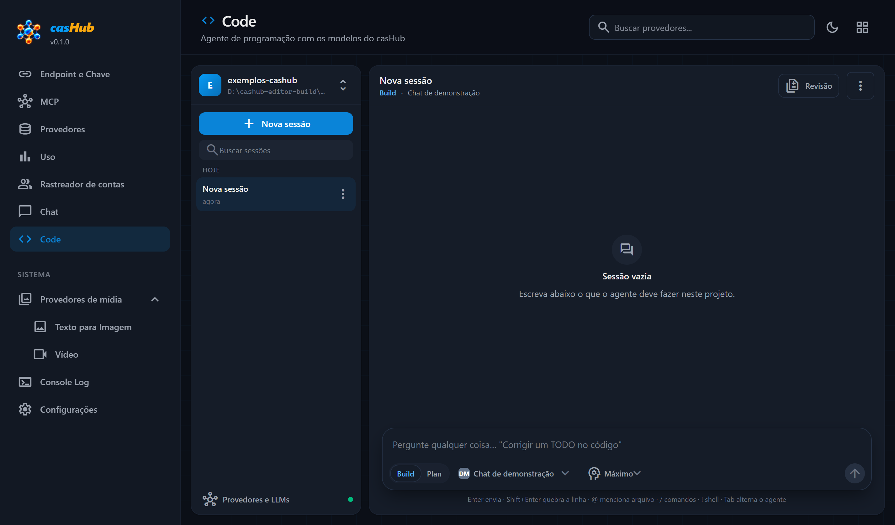
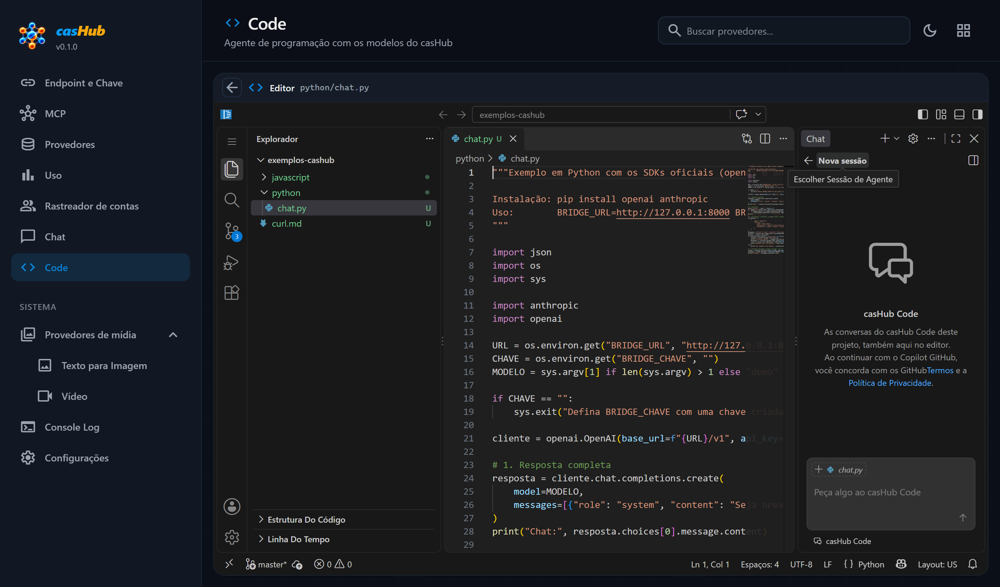
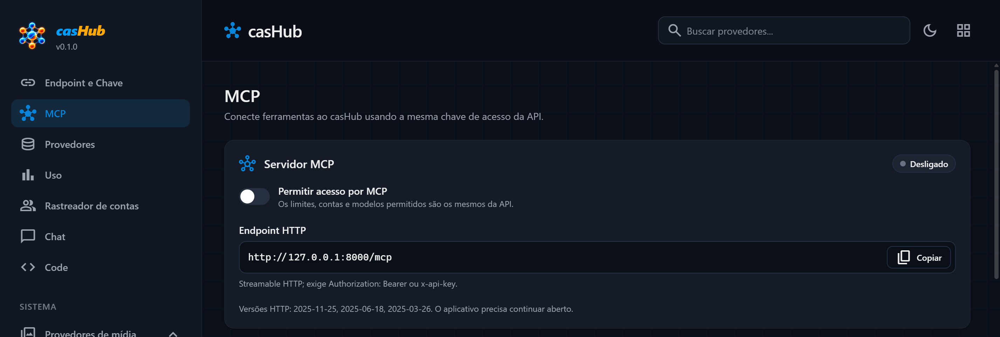
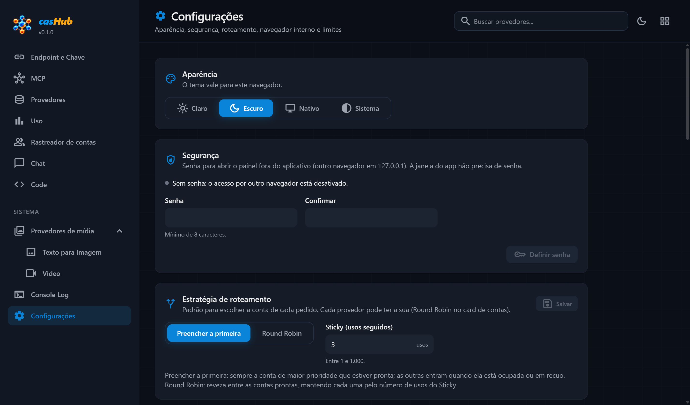

<p align="center">
  
</p>

<h1 align="center">casHub</h1>

<p align="center">
  <b>Os chats de IA do seu navegador viram uma API local, no padrão OpenAI e Anthropic.</b><br>
  ChatGPT, Gemini, Claude, Perplexity e outros, com as suas próprias contas, atrás de um único endereço na sua máquina.
</p>

<p align="center">
  <a href="https://github.com/cas1260/casHub-app/releases/latest"><b>Baixar a versão 0.1.0</b></a>
  &nbsp;·&nbsp; Windows 10/11 &nbsp;·&nbsp; macOS (Apple Silicon e Intel) &nbsp;·&nbsp; uso gratuito
</p>



---

## O que é

O casHub é um aplicativo de desktop com um navegador interno.

- Você entra nos sites oficiais de IA **dentro do aplicativo**, com as suas contas.
- O casHub abre uma API em `http://127.0.0.1:8000` que fala os protocolos da OpenAI e da Anthropic.
- Cada pedido feito a essa API é digitado no site oficial, numa aba do próprio aplicativo, e a resposta volta no formato que o seu programa já entende.

Qualquer SDK, script ou ferramenta que funcione com a OpenAI ou com a Anthropic passa a funcionar com o casHub trocando três coisas: a **URL-base**, a **chave** e o **nome do modelo**.

```
 Seu app / SDK / ferramenta
        │  POST http://127.0.0.1:8000/v1/chat/completions  { "model": "gemini", ... }
        ▼
┌────────────────────────────────── casHub (desktop) ──────────────────────────────────┐
│  API local (127.0.0.1)  →  fila  →  escolhe uma conta livre daquele site               │
│        ▲                                            │                                  │
│        │ JSON / streaming                           ▼                                  │
│  resposta no protocolo pedido  ◀──  captura  ◀──  aba interna logada no site oficial   │
└────────────────────────────────────────────────────────────────────────────────────────┘
```

## Baixar

Os instaladores ficam na página de **[Releases](https://github.com/cas1260/casHub-app/releases/latest)**.

| Sistema | Arquivo | Para quem |
|---|---|---|
| Windows 10/11 (64 bits) | `casHub-0.1.0-Setup.exe` | instalador: cria atalhos e o desinstalador, sem pedir administrador |
| Windows 10/11 (64 bits) | `casHub-0.1.0-win-x64.zip` | portátil: extraia e abra o `casHub.exe` |
| macOS 13 ou mais novo, Apple Silicon (M1 em diante) | `casHub-0.1.0-mac-arm64.dmg` | Macs com processador da Apple |
| macOS 13 ou mais novo, Intel | `casHub-0.1.0-mac-x64.dmg` | Macs com processador Intel |

A instalação é **limpa**: o aplicativo vem sem conta, sem chave e sem histórico. Tudo é criado na sua máquina, na primeira abertura.

O passo a passo de cada sistema está em [Instalação](#instalação).

## O que ele faz

- **API nos padrões que você já usa.** OpenAI Chat Completions, Responses, Models, Images e Videos, e Anthropic Messages, em JSON e em streaming (SSE).
- **Vários sites, um endereço.** Dez sites reais prontos para uso (ChatGPT, Gemini, Claude, Perplexity, Lumo, Amazon Nova, Arena, DeepSeek, LongCat e Muse) e um catálogo de 50 provedores.
- **Várias contas por site.** O casHub reveza as contas, põe em pausa a que bateu o limite e segue com a próxima. Cada conta atende um pedido por vez.
- **Login dentro do aplicativo.** Você entra no site como sempre entrou, na janela da conta. O casHub não vê nem guarda a sua senha.
- **Ferramentas (function calling) emuladas.** `tools` e `tool_calls` da OpenAI, `function_call` do Responses e `tool_use` da Anthropic, declarados como emulação na resposta.
- **Painel completo em português.** Provedores, contas, chaves, uso com a topologia ao vivo, rastreador de contas, chat de teste, console e configurações, com tema claro e escuro.
- **Code: agente de programação.** Projetos, sessões, agentes Build e Plan, ferramentas com pedido de permissão, revisão com diff e desfazer.
- **Editor embutido.** Um editor de código completo dentro do Code, em português, com os modelos do casHub carregados sozinhos e a conversa sincronizada nos dois sentidos.
- **MCP.** Servidor MCP por HTTP e por stdio, com a mesma chave da API. Vem desligado; você liga no painel.
- **Honesto sobre os limites.** O que um chat web não aplica (`temperature`, `max_tokens`...) é informado no cabeçalho da resposta em vez de fingir que funcionou.

## Telas

Todas as imagens abaixo foram tiradas do próprio pacote publicado, aberto com a pasta de dados vazia.

### Provedores

O catálogo de chats de texto. Cada cartão mostra a situação do site e as contas cadastradas.



### Estúdios de imagem e de vídeo

Os estúdios usam as mesmas contas e a mesma fila da API.





### Chat de teste

Converse com qualquer modelo pelo mesmo caminho da API. Na imagem, o chat de demonstração que acompanha o aplicativo: ele só repete a pergunta e serve para testar a instalação sem precisar de conta.



### Uso

Pedidos, falhas, tempos e a topologia ao vivo: o provedor que está atendendo aparece ligado ao casHub. Na imagem, um pedido feito ao chat de demonstração.



### Code, o agente de programação



### Editor embutido no Code

Clique no nome de um arquivo e o editor abre ali mesmo, em português, com o chat do casHub Code ao lado.



### MCP



### Configurações



## Em números

Números medidos nesta versão, sem arredondar para cima.

| Item | Valor |
|---|---|
| Provedores no catálogo | 50: 25 chats de texto, 14 estúdios de imagem, 10 estúdios de vídeo e 1 chat de demonstração local |
| Prontos para uso | 10 sites reais (texto) e o chat de demonstração |
| Aguardando homologação | 37: a conta já pode ser cadastrada; o pedido responde `503 provider_not_homologated` até a homologação |
| Indisponíveis no Brasil | 2 (Microsoft Copilot e Doubao) |
| Testes automáticos | 2.564 testes unitários: 2.541 aprovados, 23 pulados, 0 falhas (07/10/2026) |
| Editor embutido em português | 22.368 de 22.368 textos de tela (100%) |
| Instalação limpa | banco criado na primeira abertura com 13 tabelas, 11 vazias: 0 contas, 0 chaves, 0 pedidos |
| Onde a API escuta | só em `127.0.0.1` (a sua máquina) |

**Sites prontos para uso (texto):**

| Site | Modelo na API | Conta sem login |
|---|---|---|
| ChatGPT | `chatgpt` (e `chatgpt-instant`, `chatgpt-thinking-mini`, `chatgpt-thinking`) | aceita |
| Gemini | `gemini` | aceita |
| Claude | `claude` | não: precisa de login |
| Perplexity | `perplexity` | aceita |
| Lumo (Proton) | `lumo` | aceita |
| Amazon Nova | `amazon-nova` | aceita |
| Arena | `arena` (e `arena-battle`, `arena-agent`) | não: precisa de login |
| DeepSeek | `deepseek` | não: precisa de login |
| LongCat (Meituan) | `longcat` | aceita |
| Muse (Meta) | `muse` | não: precisa de login |

A lista exata de modelos da sua instalação vem de `GET /v1/models`.

**Imagem e vídeo:** as rotas `/v1/images/generations` e `/v1/videos` funcionam de ponta a ponta com o chat de demonstração. Nos sites reais, a geração de imagem foi homologada no ChatGPT. Os estúdios dedicados (Midjourney, Kling, Runway, Luma, Pika e os demais) estão no catálogo aguardando homologação.

## Instalação

### Windows

**Com o instalador**

1. Baixe o `casHub-0.1.0-Setup.exe` e abra.
2. O Windows pode mostrar a tela azul do SmartScreen ("O Windows protegeu o computador"), porque o aplicativo não tem assinatura digital paga. Clique em **Mais informações** e depois em **Executar assim mesmo**.
3. Siga o instalador. Ele instala só para o seu usuário, em `%LOCALAPPDATA%\Programs\casHub`, sem pedir administrador, e cria os atalhos no Menu Iniciar e na Área de Trabalho.

**Portátil**

1. Baixe o `casHub-0.1.0-win-x64.zip`.
2. Extraia a pasta inteira para onde quiser (precisa de cerca de 1 GB livre).
3. Abra o `casHub.exe`.

### macOS

1. Baixe o `.dmg` do seu processador. No menu Apple (canto superior esquerdo), abra **Sobre Este Mac**: "Chip Apple" é o `arm64`; "Processador Intel" é o `x64`.
2. Abra o `.dmg` e arraste o **casHub** para a pasta **Aplicativos**.
3. Abra o casHub. Na primeira vez o macOS bloqueia, porque o aplicativo não tem a assinatura paga da Apple (Developer ID).
4. Vá em **Ajustes do Sistema → Privacidade e Segurança**, role até o aviso sobre o casHub e clique em **Abrir Mesmo Assim**.

Se o macOS disser que o aplicativo "está danificado", é a mesma trava de aplicativo baixado da internet. Confira antes a soma SHA-256 do arquivo (veja [Conferir o download](#conferir-o-download)) e só então libere o aplicativo pelo Terminal:

```bash
xattr -dr com.apple.quarantine /Applications/casHub.app
```

Sobre os dois pacotes do Mac nesta versão:

- **Apple Silicon:** testado num Mac com chip Apple (abertura, API e editor embutido).
- **Intel:** gerado por compilação cruzada e conferido arquivo por arquivo, mas ainda não executado num Mac Intel. Se você usar e algo falhar, abra uma issue.

### Depois de abrir

- O casHub fica na bandeja do sistema e mostra o painel.
- A API responde em `http://127.0.0.1:8000`.
- Fechar a janela mantém o aplicativo e a API rodando. Use **Sair**, no ícone da bandeja, para encerrar.

## Primeiros passos

1. **Crie uma chave.** Em **Endpoint e Chave**, clique em **Criar chave** e copie o segredo (`wcb_...`). Ele aparece uma única vez.
2. **Adicione uma conta.** Em **Provedores**, escolha o site e clique em **Entrar com conta**. A janela do site abre dentro do aplicativo: faça o login normalmente e clique em **Concluir login**. Nos sites que permitem, use **Conta sem login**.
3. **Teste.** Clique em **Testar** na linha da conta, ou converse pela página **Chat**.
4. **Chame a API** com o seu programa, como nos exemplos a seguir.

Quer testar antes de cadastrar qualquer conta? Crie uma **Conta sem login** no provedor **Chat de demonstração** e use o modelo `demo`.

## Exemplos

**curl**

```bash
curl http://127.0.0.1:8000/v1/chat/completions \
  -H "Authorization: Bearer $CASHUB_CHAVE" \
  -H "Content-Type: application/json" \
  -d '{"model":"gemini","messages":[{"role":"user","content":"Explique o que é uma API em uma frase."}]}'
```

**SDK da OpenAI (Python)**

```python
import os
from openai import OpenAI

cliente = OpenAI(base_url="http://127.0.0.1:8000/v1", api_key=os.environ["CASHUB_CHAVE"],
                 timeout=330.0, max_retries=0)
resposta = cliente.chat.completions.create(model="gemini", messages=[{"role": "user", "content": "Olá!"}])
print(resposta.choices[0].message.content)
```

**SDK da OpenAI (JavaScript), com streaming**

```js
import OpenAI from "openai";

const cliente = new OpenAI({ baseURL: "http://127.0.0.1:8000/v1", apiKey: process.env.CASHUB_CHAVE, timeout: 330_000, maxRetries: 0 });
const fluxo = await cliente.chat.completions.create({ model: "chatgpt", messages: [{ role: "user", content: "Olá!" }], stream: true });
for await (const parte of fluxo) process.stdout.write(parte.choices[0]?.delta?.content ?? "");
```

**SDK da Anthropic e Claude Code**

```bash
# A base é sem /v1: o SDK acrescenta /v1/messages sozinho.
export ANTHROPIC_BASE_URL=http://127.0.0.1:8000
export ANTHROPIC_AUTH_TOKEN=wcb_sua_chave
export ANTHROPIC_MODEL=gemini
```

**Codex**, em `~/.codex/config.toml`:

```toml
model = "gemini"
model_provider = "cashub"

[model_providers.cashub]
name = "casHub"
base_url = "http://127.0.0.1:8000/v1"
env_key = "CASHUB_CHAVE"
wire_api = "responses"
request_max_retries = 0
stream_max_retries = 0
supports_websockets = false
```

**Outros clientes "compatíveis com OpenAI"** (Cline, Continue, n8n, LangChain...): URL-base `http://127.0.0.1:8000/v1`, a sua chave `wcb_...` e o nome do modelo (`gemini`, `chatgpt`, `lumo`...).

Dois cuidados que valem para todos:

- **Desligue as repetições automáticas** (`max_retries = 0`). Uma resposta de chat web pode levar minutos, e repetir o pedido duplicaria a pergunta no site.
- **Use um tempo limite longo** (os exemplos usam 330 segundos).

Os SDKs oficiais da OpenAI e da Anthropic, em JavaScript e em Python, foram testados com o casHub. Ferramentas de programação como Claude Code e Codex conectam e conversam; a execução de ferramentas por elas depende de o modelo do site obedecer ao formato e ainda não é garantida em todos os casos.

## Rotas da API

| Rota | Uso |
|---|---|
| `GET /v1/models` | modelos disponíveis para a sua chave |
| `POST /v1/chat/completions` | texto (JSON ou streaming), com ferramentas emuladas |
| `POST /v1/responses` | texto no formato Responses |
| `POST /v1/messages` | texto no formato Anthropic |
| `POST /v1/images/generations` | imagem |
| `POST /v1/videos` · `GET /v1/videos/{id}` · `GET /v1/videos/{id}/content` | vídeo assíncrono |
| `GET /bridge/v1/capabilities/{model}` | o que aquele modelo realmente suporta |
| `GET /health/live` · `GET /health/ready` | saúde do aplicativo |

A chave vai em `Authorization: Bearer <chave>` ou em `x-api-key: <chave>`.

Cabeçalhos úteis na resposta:

| Cabeçalho | Significado |
|---|---|
| `x-bridge-provider` | site que atendeu |
| `x-bridge-conta` | conta usada |
| `x-bridge-parametros-ignorados` | parâmetros aceitos e não aplicados pelo site |
| `x-bridge-ferramentas` | `emuladas`, quando o pedido usou ferramentas |
| `x-bridge-esforco` | nível de raciocínio usado |

Os erros seguem o formato da OpenAI, com códigos estáveis como `provider_not_homologated`, `no_ready_session`, `upstream_auth_required` e `input_too_large_for_provider`.

## Code e o editor embutido

O menu **Code** é o agente de programação do casHub.

- **Projetos e sessões.** Aponte uma pasta do seu computador e converse sobre ela.
- **Dois agentes.** Build executa ferramentas e altera arquivos; Plan só lê e planeja.
- **Ferramentas com permissão.** Ler, escrever, editar, buscar e rodar comandos, com pedido de aprovação na tela para o que sai da pasta do projeto, para arquivos `.env` e para chamadas repetidas.
- **Revisão.** Cada alteração aparece em diff, e dá para desfazer.
- **Modelos.** Usa os modelos do casHub (a mesma fila e as mesmas contas da API) e aceita outras APIs compatíveis com OpenAI ou Anthropic.
- **Editor embutido.** Ao clicar no nome de um arquivo, abre um editor completo dentro da tela do Code. Ele vem inteiro dentro do aplicativo: não depende de nenhum outro programa instalado. A conversa do Code aparece no chat do editor, e o que você pede no editor aparece na conversa do Code.

O agente lê e grava arquivos e executa comandos **na sua máquina, com as permissões do seu usuário**. Use em pastas que você conhece.

## MCP

1. Crie uma chave em **Endpoint e Chave**. O MCP usa a mesma chave e as mesmas permissões.
2. Abra **MCP** e ligue **Permitir acesso por MCP**. Ele vem desligado.
3. Escolha o seu cliente na lista, copie a configuração e troque `SUA_CHAVE` pela sua chave.

O endereço é `http://127.0.0.1:8000/mcp`. São nove ferramentas: listar e consultar modelos, consultar capacidades, enviar chat, gerar imagem e criar, consultar, baixar e excluir vídeo. Cada uma pode ser desligada separadamente.

## Segurança e privacidade

- **Só na sua máquina.** A API e o painel escutam apenas em `127.0.0.1`.
- **Chaves de API.** O segredo aparece uma vez e é guardado só como hash (SHA-256).
- **Conteúdo cifrado.** Pedidos, respostas e arquivos gerados ficam cifrados no disco (AES-256-GCM). A chave mestra é protegida pelo próprio sistema operacional (no macOS, pelas Chaves do sistema: ele pode pedir a sua permissão na primeira abertura).
- **Senhas.** O login acontece na página do site. O casHub não vê nem guarda a sua senha. As sessões ficam em áreas separadas por conta, na pasta de dados do aplicativo.
- **Registros.** Os logs e o painel não mostram o conteúdo das conversas.
- **Painel por outro navegador.** Só funciona depois que você define uma senha em Configurações. A janela do aplicativo entra direto.
- **O que sai da sua máquina.** O conteúdo que você envia vai para o site escolhido, com a sua conta. Apagar os dados locais não apaga o histórico que fica na conta do site.

## Limitações

- O aplicativo precisa estar aberto. A API funciona enquanto ele roda, inclusive na bandeja.
- Os sites mudam de interface. Um site pode parar de funcionar até a próxima versão do casHub (erro `selector_mismatch`).
- Login, verificação em duas etapas e desafios do tipo CAPTCHA são resolvidos por você, na janela da conta. O casHub **não** contorna CAPTCHA.
- Não há contagem real de tokens nem de custo. `temperature`, `max_tokens` e parecidos não controlam o site.
- Pedidos muito grandes podem passar do limite de entrada do site e recebem `400 input_too_large_for_provider`. O casHub não corta o texto por conta própria.
- A velocidade é a do site: cada resposta leva o tempo que o chat web leva para responder.
- No Code, os modelos do casHub recebem só texto.
- Cotas gratuitas, marca d'água e disponibilidade por região dependem de cada site e mudam com frequência.
- Windows é a plataforma principal de desenvolvimento e de testes.

## Conferir o download

Cada versão publica o arquivo `SHA256SUMS.txt` com a soma de cada pacote. Para conferir:

```powershell
Get-FileHash .\casHub-0.1.0-Setup.exe -Algorithm SHA256
```

```bash
shasum -a 256 casHub-0.1.0-mac-arm64.dmg
```

O resultado tem de ser igual à linha do arquivo em `SHA256SUMS.txt`.

## Dados, atualização e desinstalação

| Sistema | Pasta de dados |
|---|---|
| Windows | `%APPDATA%\webchat-api-bridge` |
| macOS | `~/Library/Application Support/webchat-api-bridge` |

- **Atualizar:** instale a versão nova por cima. Os dados ficam na pasta acima e são mantidos.
- **Desinstalar no Windows:** **Aplicativos instalados → casHub → Desinstalar**. Na versão portátil, apague a pasta.
- **Desinstalar no macOS:** arraste o casHub da pasta Aplicativos para o Lixo.
- A desinstalação **não apaga os dados**. Para remover tudo (contas, chaves e histórico), apague também a pasta de dados com o aplicativo fechado.

Variáveis opcionais: `BRIDGE_PORTA` troca a porta da API (padrão 8000) e `BRIDGE_DADOS` troca a pasta de dados.

## Licença

© 2026 Cleber de Almeida Soares. Todos os direitos reservados.

O casHub é de **uso gratuito**. Não é permitido vender, distribuir versões modificadas nem fazer engenharia reversa do aplicativo. O texto completo está em [LICENSE.md](LICENSE.md).

O aplicativo inclui componentes de código aberto de terceiros, cada um com a sua licença. Os avisos de licença desses componentes acompanham o aplicativo instalado.

Este repositório publica o aplicativo pronto para uso. O código-fonte do casHub não é distribuído aqui.

## Aviso de uso

O casHub automatiza sites de terceiros usando **as suas próprias contas**, na sua máquina. Alguns serviços restringem o uso automatizado nos termos de uso. Verifique os termos de cada site e use por sua conta e responsabilidade.

O casHub não tem vínculo com a OpenAI, a Anthropic, o Google, a Microsoft nem com nenhum dos sites do catálogo. As marcas pertencem aos seus donos.

O aplicativo não oferece contorno de CAPTCHA, rotação de identidades, remoção de marca d'água nem qualquer forma de burlar limites.
